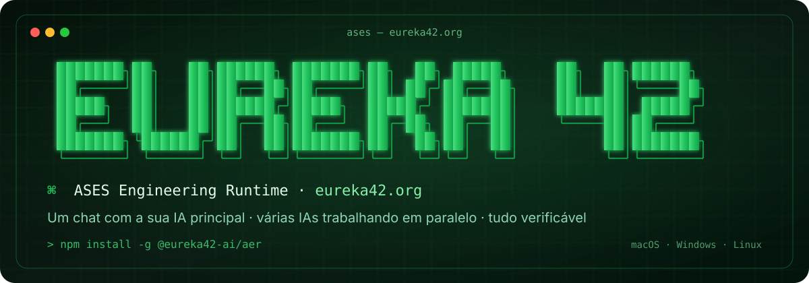

<div align="center">



<br/>

[](https://www.npmjs.com/package/@eureka42-ai/aer)
[](https://github.com/eureka42-ai/ases-cli/actions)


[](LICENSE)

**Um chat no terminal com a sua IA principal, que divide o trabalho entre várias IAs ao mesmo tempo, com testes, revisão e tudo rastreável.**

[Instalar](#-instalação) · [Primeiros passos](#-primeiros-passos) · [Metodologia](#-projeto-novo-com-a-metodologia-ases-300500) · [Como funciona](#-como-funciona) · [Comandos](#-comandos) · [Autores](#-autores) · [Versões](#️-histórico-de-versões) · [eureka42.org](https://eureka42.org)

</div>

---

## ✨ O que é

O **AER (ASES Engineering Runtime)** é o motor de engenharia de software orientada a agentes da **Eureka42**. Você conversa em texto livre, como num chat. Uma **IA principal**, escolhida por você, responde, lê e edita o projeto. Quando o pedido é grande, o **ASES** divide o trabalho em tarefas e distribui entre as **outras IAs instaladas** (Claude Code, Codex, Kimi, OpenCode, Antigravity, Cursor), que trabalham **em paralelo**, cada uma na sua cópia isolada do projeto.

Tudo segue a metodologia **ASES-300**: requisitos rastreáveis, fases, tarefas, evidências e gates verificáveis.

<div align="center">

<br/><sub>Ilustração da interface do <code>ases</code>.</sub>
</div>

## 🚀 Destaques

| | |
|---|---|
| 💬 **Chat com a IA principal** | Converse em português. A principal lê, planeja e edita; `/desfazer` volta qualquer edição dela. |
| ⚡ **Várias IAs em paralelo** | Um pedido grande vira um **plano**. O ASES escolhe a IA de cada tarefa, explica por que, e roda tudo ao mesmo tempo em *worktrees* Git separadas. |
| ✅ **Qualidade automática** | Testes obrigatórios (até 2 refações), **revisão cruzada** por outra IA e **troca automática** de IA quando a cota acaba ou ela trava. |
| 👀 **Você vê tudo acontecendo** | Cada ação aparece na hora (`● Lendo src/app.ts`), e o que mudou vem com `+N −M` e as linhas em verde/vermelho. |
| 📡 **`ases-tar`: monitor ao vivo** | Em outro terminal: qual IA está em qual tarefa, a última ação de cada uma e o que a principal está fazendo. |
| 🔐 **Seguro por padrão** | Sem shell, sem servidor de rede, sem login feito pelo AER. Nada entra no projeto sem `/aceitar`. |
| 🧭 **Metodologia ASES-300/500** | 300 requisitos gerais, entrevista por trilhas, decisões, CHANGE e gates G0/G1, tudo no `.ases/`. |
| 🖥️ **Multiplataforma** | macOS (Apple Silicon), Windows e Linux (x64 e arm64), testados no CI a cada mudança. |

## 📦 Instalação

> Requisitos: **Node.js 22.18 ou mais novo** e **Git**.

```sh
npm install -g @eureka42-ai/aer
ases --version
```

O pacote traz **dois comandos**: `ases` (o chat) e `ases-tar` (o monitor). Funciona igual em zsh, bash, PowerShell e cmd.

**Atualizar** (só quando você pedir; nada é verificado em segundo plano):

```sh
ases update          # instala a versão mais nova
ases update --check  # só mostra se há versão nova
```

**Desinstalar:** `npm uninstall -g @eureka42-ai/aer`. Os dados dos seus projetos não são apagados.

## 🏁 Primeiros passos

1. **Instale e faça login, no próprio programa de cada uma, em pelo menos uma IA**: Claude Code, Codex, Kimi, OpenCode ou Antigravity. O AER **nunca** faz login por você.
2. Abra o terminal e rode **`ases`**. Ele pergunta **"Onde vamos trabalhar?"**: *Esta pasta*, *Mesa*, *Escolher uma pasta…* ou um projeto recente. A pasta escolhida vira projeto sozinha.
3. Na primeira vez, um assistente (que não usa IA nem gasta cota) mostra as IAs encontradas e pergunta:
   - qual será a **principal**;
   - se o AER pode usar as suas IAs sem perguntar de novo (fica **só** na sua config pessoal);
   - o **modo** (manual, automático ou híbrido);
   - o **limite** de tarefas por IA;
   - o **comando de teste** do projeto.
4. **Converse.** Para trabalho grande, peça e confira o plano: `Enter` executa, `Ctrl+E` edita, `Ctrl+N` descarta.
5. Em outro terminal, rode **`ases-tar`** para acompanhar tudo ao vivo.
6. Confira com `/ver 12` e traga para o projeto com `/aceitar`.

## 🧭 Projeto novo com a metodologia ASES-300/500

O `/iniciar-projeto` (desde a 1.3.0) guia tudo no próprio chat, do zero ao repositório no GitHub:

```sh
mkdir ~/Projetos/meu-sistema && cd ~/Projetos/meu-sistema
ases                       # escolha "Esta pasta"
```

```
> /iniciar-projeto
```

| Etapa | O que acontece | Você faz |
|---|---|---|
| **1. Preparação** | Cria o Git, se faltar, e importa e confere as fontes ASES (SHA-256); roda o **G0** | nada |
| **2. Entrevista ASES-500** | As perguntas das trilhas A–J, **uma por vez**, com progresso (`Pergunta A.1 (1/24)`) | responde em texto livre, ou `/proposta <texto>`, `/na <motivo>`, `/pular` |
| **3. Requisitos do sistema** | Cada linha vira um **REQ-301+**, aprovado com o seu nome | `título :: critério de aceite`, e `/pronto` no fim |
| **4. ASES-300** | Os **300 requisitos gerais**, um por vez | `Enter` = se aplica, `/na <motivo>` = não se aplica, `/aplicar-resto` |
| **5. Fechamento** | Roda o **G1** e oferece criar o repositório no GitHub (**privado** por padrão, pelo `gh`) | `/github sim`, `/github sim nome publico` ou `/github nao` |

- **Pausar e retomar:** `/sair-entrevista` pausa. `/iniciar-projeto` continua de onde parou, porque tudo fica salvo no `.ases/`.
- **Construir:** depois, peça no chat citando os requisitos, por exemplo `crie o agendamento de consultas (REQ-301)`. A principal planeja, as IAs executam em paralelo, e `/aceitar` traz o trabalho para o projeto.
- **Comprovar:** `/req set REQ-301 PASS --evidence <arquivo>`.
- **Mudar algo aprovado:** `/change new --approved-by <nome> --targets REQ-301 <motivo>`.
- **O que fica registrado:** a matriz de requisitos, as decisões e a rastreabilidade (requisito → fase → tarefa → teste) em `.ases/`. O fluxo manual, comando a comando, está em [`docs/METODOLOGIA.md`](docs/METODOLOGIA.md).

> A ASES-500 é uma consolidação **para validação** (não é um original homologado). A entrevista usa as perguntas literais da fonte e não é gerada por IA.

## 🧠 Como funciona

<div align="center">

</div>

- **IA principal:** cada mensagem vira um turno dela. Antes de cada turno, o ASES grava um **ponto de restauração** Git, sem tocar no seu *index* nem no seu branch.
- **Planos:** a principal devolve um bloco `aer-plan` com as tarefas. O ASES valida, escolhe a IA de cada uma (**nunca a principal**, se houver outra livre) e executa com o scheduler, com leases e *fencing*.
- **Paralelismo:** uma sessão por IA ao mesmo tempo, conforme os termos de uso individual. Com 5 IAs, são até 5 tarefas simultâneas. `/config limite` aumenta, com confirmação.
- **Rastreabilidade:** cada passo é um **evento** no banco local (SQLite, em modo WAL). O `.ases/` traz `STATUS`, `HANDOFF`, `NEXT-STEPS`, evidências e a trilha `AER-REQ → PHASE → TAR → teste`.

## ⌨️ Comandos

Digite `/` no `ases` para abrir o menu. Cada comando em português tem o equivalente em inglês.

| Comando | O que faz | Comando | O que faz |
|---|---|---|---|
| `/ia [nome]` | mostra ou troca a principal | `/ver 12` | o que a tarefa 12 mudou |
| `/ias` | IAs instaladas, prontas, ocupadas | `/aceitar [12]` | traz o trabalho pronto para o projeto |
| `/plano` | mostra o plano; `Enter` executa | `/refazer 12 motivo` | devolve a tarefa com o motivo |
| `/auto` | liga/desliga o modo automático | `/trocar 12 kimi` | troca a IA da tarefa |
| `/tarefas` | tarefas da conversa, ao vivo | `/desfazer` | desfaz a última edição da principal |
| `/parar` · `Esc` | para tudo / interrompe a IA | `/nova` | nova conversa |
| `/config` | tema, logo, modo, limites, teste, autorizações | `/atualizar` | atualiza o AER |
| `/sobre` | quem faz o Eureka42 | `/ajuda avançado` | fases, tarefas, gates, requisitos |
| `/iniciar-projeto` | metodologia guiada do zero (ASES-500 → ASES-300 → GitHub) | `/modelo` | modelo de cada IA |
| `/licao <texto>` | registra uma lição que toda IA passa a seguir (ESAA) | `/licoes` | lições do projeto (e as sugeridas, para aprovar) |
| `/verificar` | confere o projeto contra o histórico e a cadeia de integridade (ESAA) | `/metricas` | quanto cada IA rende neste projeto |
| `/problemas` | problemas registrados, com sintoma e como reproduzir (ESAA) | `/exportar-esaa` | histórico no formato do ESAA |
| `/sincronizar` | leva o projeto a outra máquina: GitHub, nuvem ou os dois | `/sync` | o mesmo, em inglês |

## 🤖 IAs suportadas

| IA | Como o AER usa | Contrato |
|---|---|---|
| **Claude Code** | `claude -p` com saída `stream-json` | VERIFIED 2.1.330 |
| **Codex** | `codex exec --json` | VERIFIED 0.170.0 |
| **Kimi** | ACP (stdio) | VERIFIED 1.50.0 |
| **OpenCode** | ACP (stdio) | VERIFIED 2.4.1 |
| **Google (Antigravity CLI)** | ACP (stdio) | VERIFIED 1.5.13 |
| **Cursor** | `cursor-agent -p` com saída `stream-json`; shell barrado pela regra `deny` do AER | VERIFIED 2026.11.22 |
| **Simulador** | determinístico, sem IA nem custo | para testes |

Cada IA usa a **sua** sessão oficial, conta e cota. No Windows, os atalhos `.cmd` do npm são abertos sem shell.

## 🔐 Segurança

- **Sem shell** em nenhum processo (`shell:false`, verificado por lint) e **sem servidor de rede**: o único canal é o IPC local, por socket Unix ou Named Pipe, com tokens.
- **Autorização por IA:**
  - a autorização vale só na **sua config pessoal**;
  - um `.ases/CONFIG.json` vindo pelo Git **não consegue** autorizar IAs nem rodar comandos;
  - o mesmo vale para o comando de teste, que só roda sozinho com a sua autorização local.
- **A principal nunca escreve** em `.git`, `.ases` ou segredos (`.env`, chaves). Os caminhos são normalizados antes da checagem.
- **Proteção de dados:** os segredos são redigidos antes de qualquer registro, e o cofre é o nativo do sistema (Keychain, Credential Manager, Secret Service).
- **Extensões** (Skills, MCP, plugins) passam por inspeção, e as aprovações ficam ligadas ao hash da operação.

## 🖥️ Plataformas

| Alvo | Situação |
|---|---|
| macOS Apple Silicon | ✅ CI + verificação local |
| Windows x64 / arm64 | ✅ CI, incluindo a TUI num ConPTY real |
| Linux x64 / arm64 | ✅ CI |
| macOS Intel | fora do escopo |

A matriz gerada dos jobs reais está em [`docs/MATRIZ_SUPORTE.md`](docs/MATRIZ_SUPORTE.md).

## 🧩 Arquitetura do código

Monorepo TypeScript (npm workspaces) com fronteiras verificadas por lint:

```
apps/ases-cli        o chat (TUI Ink), comandos, sessão, assistente, update
apps/ases-tar        monitor somente leitura ao vivo
packages/scheduler   planos, atribuição, execução paralela, qualidade, handoff
packages/persistence event store SQLite, migrações, projeções
packages/git-bridge  worktrees, merge, pontos de restauração
packages/provider-*  Claude, Codex, ACP (Kimi/OpenCode/Google) e simulador
packages/platform-*  macOS, Windows, Linux (IPC, cofre, DACL, processos)
packages/branding    logo Eureka42, temas, banner
```

## 🛠️ Desenvolvimento

```sh
git clone https://github.com/eureka42-ai/ases-cli.git
cd ases-cli
npm ci
npm run verify      # lint + typecheck + build + todos os testes
node scripts/pack.mjs && node scripts/pack-smoke.mjs   # pacote e instalação de teste
```

Os testes usam processos reais, pty, ConPTY no Windows e um simulador de IA. Nenhuma IA real é chamada nos testes.

## 📚 As bases: ASES-300/500 e ESAA

O AER junta duas linhas de trabalho dos professores do Eureka42. Uma define **o que** construir e **com que critério**; a outra garante **como** as IAs trabalham sem atropelar umas às outras.

### ASES-300 e ASES-500: Profs. Raul el Greco e Giuseppe Favato

O **ASES** é a metodologia de **Engenharia de Software Orientada a Agentes** desenvolvida pelos **Profs. Raul el Greco** e **Giuseppe Favato**. Ela é um modelo didático e operacional para construir software com agentes de IA. Ela tem duas partes:

| Parte | O que é | Para que serve |
|---|---|---|
| **ASES-500** | O especificador interativo: uma entrevista em trilhas (produto, usuários, dados, segurança, operação…), uma pergunta por vez | Transformar uma ideia solta em decisões registradas e em requisitos do **seu** sistema (REQ-301 em diante), cada um com critério de aceite verificável |
| **ASES-300** | Um catálogo de **300 requisitos gerais**, que valem para quase todo software (segurança, testes, rastreabilidade, acessibilidade, operação…) | Garantir que nada essencial fique esquecido. Cada requisito é aplicado ou marcado como "não se aplica", com justificativa e aprovação de uma pessoa |

**Por que nasceu:** quando agentes de IA passaram a investigar repositórios, alterar vários arquivos e executar comandos sozinhos, a facilidade de gerar código criou a impressão de que especificar, validar e governar o desenvolvimento tinha ficado menos necessário. Os professores viram o contrário. Um pedido como "precisamos de um sistema de usuários" não descreve um sistema: ele só inicia uma investigação. E o agente raciocina apenas a partir do contexto que recebe, então o que não foi dito simplesmente não existe para ele. Prompts cada vez maiores não resolvem: escrever "todas as rotas devem ser protegidas" não prova que uma rota nova recebeu autorização. O ASES foi criado para dar uma linguagem comum a humanos e agentes, respondendo de forma verificável **o que deve existir, por que, como será construído e como se demonstra que funciona**:
- **perguntar antes de construir** (ASES-500);
- **conferir contra uma lista madura do que todo software precisa** (ASES-300);
- **ligar cada linha de código a um requisito aprovado e a uma evidência.**

No AER, tudo isso roda com o `/iniciar-projeto`.

### ESAA: Prof. Elzo Brito

O **ESAA** (*Event Sourcing for Autonomous Agents*) é a arquitetura de governança para agentes de código criada pelo **Prof. Elzo Brito** (Elzo Brito dos Santos Filho). Há [artigo publicado no arXiv](https://arxiv.org/abs/2602.23193) e [código aberto (MIT)](https://github.com/elzobrito/ESAA-Core).

**Por que nasceu:** nas palavras do próprio projeto, agentes de código "são bons em produzir artefatos e ruins em disciplina operacional". Sem governança, um fluxo com várias IAs sofre de:
- **estado mágico:** arquivos mudam sem registro de quem, quando e por quê;
- **histórico invisível:** decisões se perdem no meio de um prompt;
- **colapso de etapas:** o agente reivindica, executa e aprova tudo de uma vez;
- **retrabalho:** o mesmo erro se repete, porque nada registra a lição.

**A ideia central:** todo avanço é um **evento imutável**, validado por um **único escritor**. Os agentes só **emitem intenções**, e o estado do projeto pode ser **reconstruído e verificado** a partir do histórico. Somam-se a isso:
- limites de escrita por tipo de tarefa;
- revisão por um agente diferente do que executou;
- **lições aprendidas** que passam a valer em toda tarefa seguinte.

### Por que juntar os dois

| Sozinho, o ASES… | Sozinho, o ESAA… | Juntos, no AER |
|---|---|---|
| diz *o que* construir e como provar que está certo | garante que cada agente siga o protocolo e deixe rastro | cada tarefa nasce de um **requisito aprovado**, roda numa **IA governada** e termina com **evidência** |
| depende de quem executa respeitar o método | não sabe *quais* requisitos o sistema precisa | a metodologia alimenta o plano, e a governança impede atalhos |
| registra decisões humanas | registra o trabalho das máquinas | **um só histórico**, do pedido do usuário à linha de código, auditável de ponta a ponta |

**O que do ESAA já roda dentro do AER (1.7.0):**

| Peça do ESAA | No AER | Comando |
|---|---|---|
| **Lições aprendidas** | Uma lição aprovada entra nas instruções de toda tarefa, das revisões e da IA principal. A própria IA sugere lições, e o ASES também sugere quando uma tarefa é bloqueada. **Nada vale sem a sua aprovação.** | `/licao <texto>`, `/licoes`, `/licao aprovar LES-0001`, `/licao arquivar LES-0001` |
| **Limites de escrita por tipo de tarefa** | Tarefa de documentação só altera documentação, a de teste só arquivos de teste, e a revisão não altera nada. Fora disso, a entrega é bloqueada antes dos testes, com a lista dos arquivos | automático nos planos |
| **Verificação pelo histórico** (*verify/replay*) | Refaz o estado de fases, tarefas e lições a partir dos eventos, confere a sequência e o hash de cada evento e aponta qualquer edição feita por fora | `/verificar` |
| **Métricas por IA** (*runner metrics*) | Tentativas, % de acerto, refações, tempo médio e tokens de cada IA no projeto, tudo tirado do histórico | `/metricas` |
| **Cadeia de integridade** (*hash chain*) | Cada evento carrega o hash do anterior. Alterar, apagar ou reordenar qualquer ponto do histórico quebra a cadeia, e o `/verificar` aponta onde. O ponto fixado fica na sua configuração pessoal, fora do projeto | `/verificar`, `/verificar fixar` |
| **Registro de problemas** (*issues*) | Todo bloqueio num plano vira um problema, com sintoma e como reproduzir. A IA principal vê os problemas abertos. `/problema corrigir` pede a correção (como o *hotfix* do ESAA), e só uma pessoa dá o problema por resolvido | `/problemas`, `/problema <título> :: <sintoma> [:: como reproduzir]`, `/problema corrigir ISS-0001`, `/problema resolver ISS-0001 <como>` |
| **Formato do ESAA** | O histórico do AER sai como `activity.jsonl` 0.4.2 do ESAA (tarefas, problemas e lições), para auditar com o próprio `esaa verify` | `/exportar-esaa` |

## 👥 Autores

<div align="center">

O **Eureka42** é uma iniciativa dos Professores

<table>
<tr>
<td align="center" width="40%">
<h2>⌘ Raul el Greco</h2>
<b>Professor · Eureka42</b><br/><sub>coautor do ASES-300/500</sub>
</td>
<td align="center" width="30%">
<h3>Giuseppe Favato</h3>
Professor · Eureka42<br/><sub>coautor do ASES-300/500</sub>
</td>
<td align="center" width="30%">
<h3>Elzo Brito</h3>
Professor · Eureka42<br/><sub>autor do <a href="https://github.com/elzobrito/ESAA-Core">ESAA</a></sub>
</td>
</tr>
</table>


**[eureka42.org](https://eureka42.org)**

</div>

## 📄 Licença

**CC BY-NC-ND 4.0** (Atribuição, Não Comercial, Sem Derivações). Veja [`LICENSE`](LICENSE).
Os avisos das bibliotecas de terceiros embutidas acompanham o pacote em `THIRD_PARTY_LICENSES.md`.

## 🗓️ Histórico de versões

| Versão | Data | Destaques |
|---|---|---|
| **1.7.0** | 27/11/2026 | ESAA: **cadeia de integridade** dos eventos (`/verificar fixar`); **registro de problemas** (`/problemas`, `/problema corrigir`); **`/exportar-esaa`** no formato do ESAA |
| 1.6.0 | 27/11/2026 | Integração com o ESAA: a IA e o ASES **sugerem lições** (você aprova); **limites de escrita** por tipo de tarefa; **`/verificar`** pelo histórico; **`/metricas`** por IA |
| 1.5.0 | 26/11/2026 | **Lições aprendidas** do ESAA (`/licao`, `/licoes`) em toda tarefa e na principal; seção "As bases: ASES-300/500 e ESAA"; `/sobre` com os autores; `ases update` sem cache velho |
| 1.4.0 | 26/11/2026 | Projetos em outra máquina: **Novo projeto** em `~/Projetos Eureka42`, guardado só local, no GitHub, na nuvem (Google Drive, OneDrive, Mega… pelo rclone) ou nos dois, com o contexto junto; **Abrir de outra máquina**; `/sincronizar`; pedidos de aprovação da IA em `/approval`; cores na marca Eureka42; interface no idioma da máquina (pt/en/es); modelo da principal no cabeçalho |
| 1.3.1 | 25/11/2026 | `/modelo` com as listas atuais: Claude 5.5/Fable 5.2, Codex GPT-6/5.6, Kimi K3.1 |
| 1.3.0 | 25/11/2026 | `/iniciar-projeto`: ASES-500 guiada → requisitos → ASES-300 → G1 → repositório no GitHub (privado por padrão) |
| 1.2.1 | 25/11/2026 | Cursor seguro: shell barrado pela regra `deny` antes de executar e acesso fora do projeto interrompido; Cursor **VERIFIED** 2026.11.22 |
| 1.2.0 | 25/11/2026 | Cursor como nova IA (não use: o shell não era barrado; use a 1.2.1) |
| 1.1.2 | 24/11/2026 | Abertura limpa; `/modelo` com seletor (← → ↑ ↓ e Espaço); Codex em pasta sem Git; plano avisa quando falta Git |
| 1.1.1 | 24/11/2026 | Visual no estilo do Claude Code (`>`, `●`, ações ao vivo, diff +/−, ✻ pensando com o tempo, `Esc`); tela "Onde vamos trabalhar?" sem `ases init`; autorização única das IAs; `ases-tar` mostra quem faz o quê |
| 1.1.0 | 24/11/2026 | Chat com a IA principal, planos em paralelo entre IAs, revisão cruzada, troca automática, testes obrigatórios, comandos em português, banner verde, `ases update` |
| 1.0.1 | 24/11/2026 | Windows: IAs instaladas pelo npm (`.cmd`) passam a ser detectadas |
| 1.0.0 | 24/11/2026 | Primeiro release: `ases` + `ases-tar`, motor local, 5 IAs, ASES-300/500, segurança, macOS/Windows/Linux |

Detalhes de cada versão em [`docs/RELEASE_NOTES.md`](docs/RELEASE_NOTES.md).

<div align="center"><sub>⌘ Eureka42 · ASES Engineering Runtime</sub></div>
