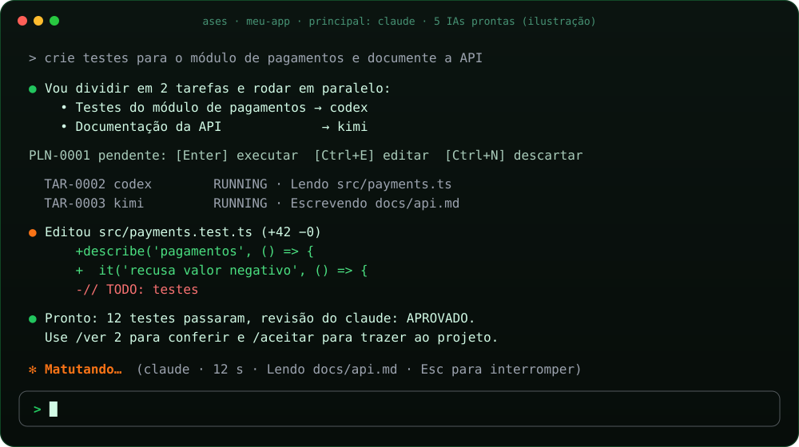
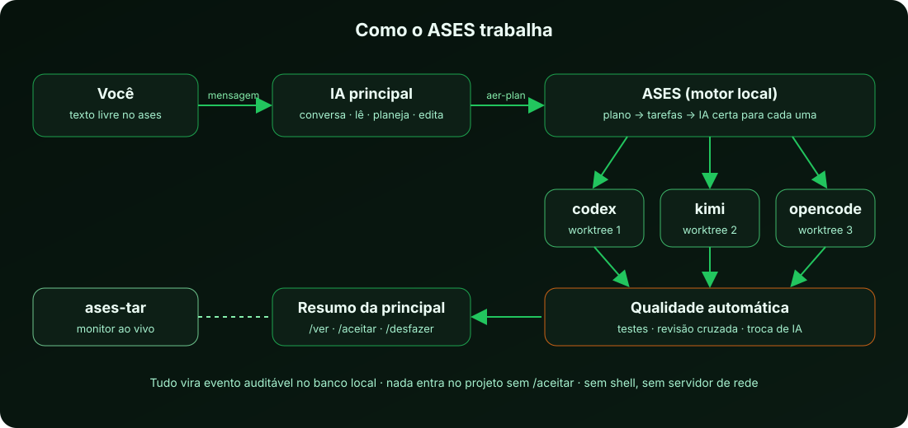

<div align="center">


<br/>

[](https://www.npmjs.com/package/@eureka42-ai/aer)
[](https://github.com/eureka42-ai/ases-cli/actions)


[](LICENSE)

**Um chat no terminal com a sua IA principal, que divide o trabalho entre várias IAs ao mesmo tempo, com testes, revisão e tudo rastreável.**

[Instalar](#-instalação) · [Primeiros passos](#-primeiros-passos) · [Como funciona](#-como-funciona) · [Comandos](#-comandos) · [Autores](#-autores) · [eureka42.org](https://eureka42.org)

</div>

---

## ✨ O que é

O **AER (ASES Engineering Runtime)** é o motor de engenharia de software orientada a agentes da **Eureka42**. Você conversa em texto livre, como num chat. Uma **IA principal**, escolhida por você, responde, lê e edita o projeto. Quando o pedido é grande, o **ASES** divide o trabalho em tarefas e distribui entre as **outras IAs instaladas** (Claude Code, Codex, Kimi, OpenCode, Antigravity, Cursor), que trabalham **em paralelo**, cada uma na sua cópia isolada do projeto.

Tudo segue a metodologia **ASES-300**: requisitos rastreáveis, fases, tarefas, evidências e gates verificáveis.

<div align="center">

<br/><sub>Ilustração da interface do <code>ases</code>.</sub>
</div>

## 🚀 Destaques

| | |
|---|---|
| 💬 **Chat com a IA principal** | Converse em português. A principal lê, planeja e edita; `/desfazer` volta qualquer edição dela. |
| ⚡ **Várias IAs em paralelo** | Um pedido grande vira um **plano**. O ASES escolhe a IA de cada tarefa, explica por que, e roda tudo ao mesmo tempo em *worktrees* Git separadas. |
| ✅ **Qualidade automática** | Testes obrigatórios (até 2 refações), **revisão cruzada** por outra IA e **troca automática** de IA quando a cota acaba ou ela trava. |
| 👀 **Você vê tudo acontecendo** | Cada ação aparece na hora (`● Lendo src/app.ts`), e o que mudou vem com `+N −M` e as linhas em verde/vermelho. |
| 📡 **`ases-tar`: monitor ao vivo** | Em outro terminal: qual IA está em qual tarefa, a última ação de cada uma e o que a principal está fazendo. |
| 🔐 **Seguro por padrão** | Sem shell, sem servidor de rede, sem login feito pelo AER. Nada entra no projeto sem `/aceitar`. |
| 🧭 **Metodologia ASES-300/500** | 300 requisitos gerais, entrevista por trilhas, decisões, CHANGE e gates G0/G1, tudo no `.ases/`. |
| 🖥️ **Multiplataforma** | macOS (Apple Silicon), Windows e Linux (x64 e arm64), testados no CI a cada mudança. |

## 📦 Instalação

> Requisitos: **Node.js 22.18 ou mais novo** e **Git**.

```sh
npm install -g @eureka42-ai/aer
ases --version
```

O pacote traz **dois comandos**: `ases` (o chat) e `ases-tar` (o monitor). Funciona igual em zsh, bash, PowerShell e cmd.

**Atualizar** (só quando você pedir; nada é verificado em segundo plano):

```sh
ases update          # instala a versão mais nova
ases update --check  # só mostra se há versão nova
```

**Desinstalar:** `npm uninstall -g @eureka42-ai/aer`. Os dados dos seus projetos não são apagados.

## 🏁 Primeiros passos

1. **Instale e faça login, no próprio programa de cada uma, em pelo menos uma IA**: Claude Code, Codex, Kimi, OpenCode ou Antigravity. O AER **nunca** faz login por você.
2. Abra o terminal e rode **`ases`**. Ele pergunta **"Onde vamos trabalhar?"**: *Esta pasta*, *Mesa*, *Escolher uma pasta…* ou um projeto recente. A pasta escolhida vira projeto sozinha.
3. Na primeira vez, um assistente (que não usa IA nem gasta cota) mostra as IAs encontradas e pergunta:
   - qual será a **principal**;
   - se o AER pode usar as suas IAs sem perguntar de novo (fica **só** na sua config pessoal);
   - o **modo** (manual, automático ou híbrido);
   - o **limite** de tarefas por IA;
   - o **comando de teste** do projeto.
4. **Converse.** Para trabalho grande, peça e confira o plano: `Enter` executa, `Ctrl+E` edita, `Ctrl+N` descarta.
5. Em outro terminal, rode **`ases-tar`** para acompanhar tudo ao vivo.
6. Confira com `/ver 12` e traga para o projeto com `/aceitar`.

## 🧠 Como funciona

<div align="center">

</div>

- **IA principal:** cada mensagem vira um turno dela. Antes de cada turno, o ASES grava um **ponto de restauração** Git, sem tocar no seu *index* nem no seu branch.
- **Planos:** a principal devolve um bloco `aer-plan` com as tarefas. O ASES valida, escolhe a IA de cada uma (**nunca a principal**, se houver outra livre) e executa com o scheduler, com leases e *fencing*.
- **Paralelismo:** uma sessão por IA ao mesmo tempo, conforme os termos de uso individual. Com 5 IAs, são até 5 tarefas simultâneas. `/config limite` aumenta, com confirmação.
- **Rastreabilidade:** cada passo é um **evento** no banco local (SQLite, em modo WAL). O `.ases/` traz `STATUS`, `HANDOFF`, `NEXT-STEPS`, evidências e a trilha `AER-REQ → PHASE → TAR → teste`.

## ⌨️ Comandos

Digite `/` no `ases` para abrir o menu. Cada comando em português tem o equivalente em inglês.

| Comando | O que faz | Comando | O que faz |
|---|---|---|---|
| `/ia [nome]` | mostra ou troca a principal | `/ver 12` | o que a tarefa 12 mudou |
| `/ias` | IAs instaladas, prontas, ocupadas | `/aceitar [12]` | traz o trabalho pronto para o projeto |
| `/plano` | mostra o plano; `Enter` executa | `/refazer 12 motivo` | devolve a tarefa com o motivo |
| `/auto` | liga/desliga o modo automático | `/trocar 12 kimi` | troca a IA da tarefa |
| `/tarefas` | tarefas da conversa, ao vivo | `/desfazer` | desfaz a última edição da principal |
| `/parar` · `Esc` | para tudo / interrompe a IA | `/nova` | nova conversa |
| `/config` | tema, logo, modo, limites, teste, autorizações | `/atualizar` | atualiza o AER |
| `/sobre` | quem faz o Eureka42 | `/ajuda avançado` | fases, tarefas, gates, requisitos |

## 🤖 IAs suportadas

| IA | Como o AER usa | Contrato |
|---|---|---|
| **Claude Code** | `claude -p` com saída `stream-json` | VERIFIED 2.1.330 |
| **Codex** | `codex exec --json` | VERIFIED 0.170.0 |
| **Kimi** | ACP (stdio) | VERIFIED 1.50.0 |
| **OpenCode** | ACP (stdio) | VERIFIED 2.4.1 |
| **Google (Antigravity CLI)** | ACP (stdio) | VERIFIED 1.5.13 |
| **Cursor** | `cursor-agent -p` com saída `stream-json`; shell barrado pela regra `deny` do AER | VERIFIED 2026.11.22 |
| **Simulador** | determinístico, sem IA nem custo | para testes |

Cada IA usa a **sua** sessão oficial, conta e cota. No Windows, os atalhos `.cmd` do npm são abertos sem shell.

## 🔐 Segurança

- **Sem shell** em nenhum processo (`shell:false`, verificado por lint) e **sem servidor de rede**: o único canal é o IPC local, por socket Unix ou Named Pipe, com tokens.
- **Autorização por IA:**
  - a autorização vale só na **sua config pessoal**;
  - um `.ases/CONFIG.json` vindo pelo Git **não consegue** autorizar IAs nem rodar comandos;
  - o mesmo vale para o comando de teste, que só roda sozinho com a sua autorização local.
- **A principal nunca escreve** em `.git`, `.ases` ou segredos (`.env`, chaves). Os caminhos são normalizados antes da checagem.
- **Proteção de dados:** os segredos são redigidos antes de qualquer registro, e o cofre é o nativo do sistema (Keychain, Credential Manager, Secret Service).
- **Extensões** (Skills, MCP, plugins) passam por inspeção, e as aprovações ficam ligadas ao hash da operação.

## 🖥️ Plataformas

| Alvo | Situação |
|---|---|
| macOS Apple Silicon | ✅ CI + verificação local |
| Windows x64 / arm64 | ✅ CI, incluindo a TUI num ConPTY real |
| Linux x64 / arm64 | ✅ CI |
| macOS Intel | fora do escopo |

A matriz gerada dos jobs reais está em [`docs/MATRIZ_SUPORTE.md`](docs/MATRIZ_SUPORTE.md).

## 🧩 Arquitetura do código

Monorepo TypeScript (npm workspaces) com fronteiras verificadas por lint:

```
apps/ases-cli        o chat (TUI Ink), comandos, sessão, assistente, update
apps/ases-tar        monitor somente leitura ao vivo
packages/scheduler   planos, atribuição, execução paralela, qualidade, handoff
packages/persistence event store SQLite, migrações, projeções
packages/git-bridge  worktrees, merge, pontos de restauração
packages/provider-*  Claude, Codex, ACP (Kimi/OpenCode/Google) e simulador
packages/platform-*  macOS, Windows, Linux (IPC, cofre, DACL, processos)
packages/branding    logo Eureka42, temas, banner
```

## 🛠️ Desenvolvimento

```sh
git clone https://github.com/eureka42-ai/ases-cli.git
cd ases-cli
npm ci
npm run verify      # lint + typecheck + build + todos os testes
node scripts/pack.mjs && node scripts/pack-smoke.mjs   # pacote e instalação de teste
```

Os testes usam processos reais, pty, ConPTY no Windows e um simulador de IA. Nenhuma IA real é chamada nos testes.

## 👥 Autores

<div align="center">

O **Eureka42** é uma iniciativa dos Professores

<table>
<tr>
<td align="center" width="40%">
<h2>⌘ Raul el Greco</h2>
<b>Professor · Eureka42</b>
</td>
<td align="center" width="30%">
<h3>Giuseppe Favato</h3>
Professor · Eureka42
</td>
<td align="center" width="30%">
<h3>Elzo Brito</h3>
Professor · Eureka42
</td>
</tr>
</table>


**[eureka42.org](https://eureka42.org)**

</div>

## 📄 Licença

**CC BY-NC-ND 4.0** (Atribuição, Não Comercial, Sem Derivações). Veja [`LICENSE`](LICENSE).
Os avisos das bibliotecas de terceiros embutidas acompanham o pacote em `THIRD_PARTY_LICENSES.md`.

<div align="center"><sub>⌘ Eureka42 · ASES Engineering Runtime</sub></div>
